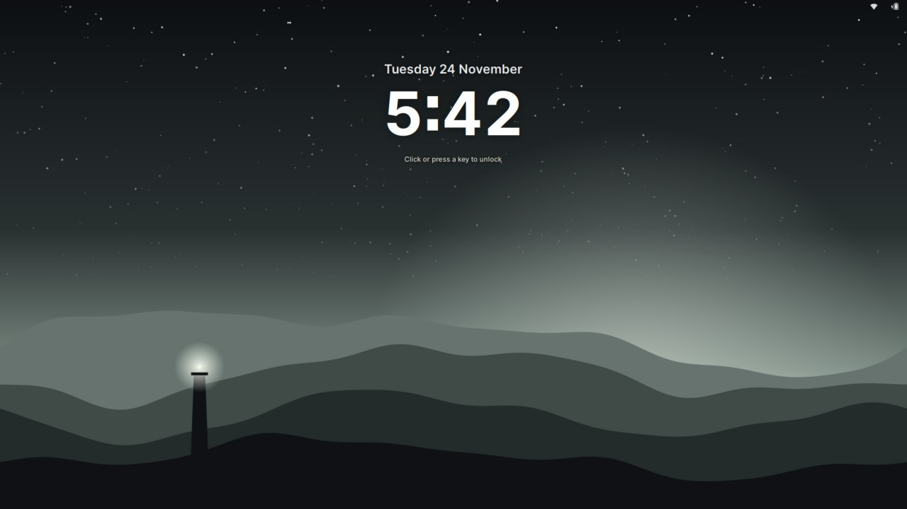
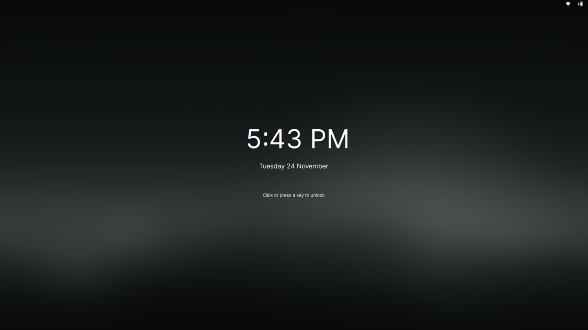
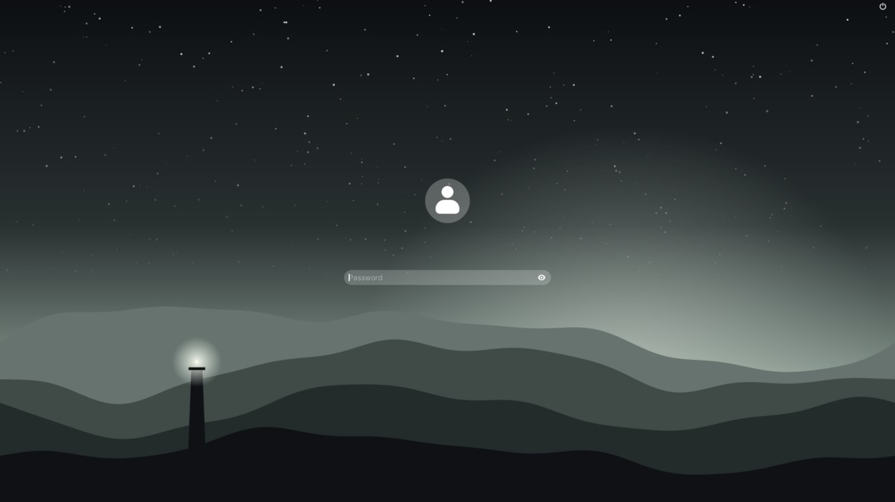
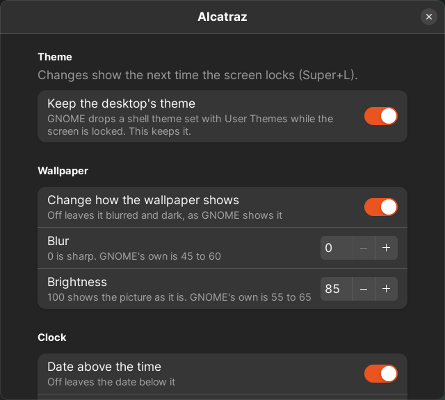

<p align="center"></p>

<h1 align="center">Alcatraz</h1>

<p align="center"><b>A Mac-style lock screen for GNOME.</b><br>
Your desktop's theme on the lock screen, the wallpaper sharp, and a big clock near the top.<br>
GNOME 42 to 51. Nothing of it runs while you work.</p>

<p align="center"></p>

## Why

GNOME switches extensions off while the screen is locked, and that includes **User Themes**, the
extension that loads a shell theme. So the lock screen falls back to the default look, whatever
theme your desktop uses, and shows your wallpaper blurred and dark.

Alcatraz is allowed to stay on while the screen is locked. At the moment of locking it:

- loads the shell theme your desktop uses,
- shows the wallpaper sharp instead of blurred and dark,
- puts the date above a large clock near the top, without AM or PM.

Every part has its own switch, and blur, brightness, the sizes, the font and the height of the
clock can be set. The name comes from the island: a locked place with a fine view.

| GNOME's own lock screen | With Alcatraz |
|---|---|
|  |  |

The same desktop in both pictures: the WhiteSur shell theme set with User Themes, and a wallpaper
of our own. The password page stays GNOME's own, in your theme:

<p align="center"></p>

## Light, and careful

- **Nothing runs while the screen is unlocked.** No timer, no polling: Alcatraz only listens for
  the screen to lock and to unlock.
- **One short moment of work per lock.** In the tests, dressing the lock screen took 50 to 170
  milliseconds, most of it loading the theme, the same work User Themes does at every unlock.
- **The password prompt is GNOME's own.** Alcatraz does not touch it, its place, or the way you
  unlock. The clock is only moved where it is painted, not in the layout.
- **It fails soft.** Alcatraz changes parts of GNOME's lock screen that are not a public
  programming interface. It checks for each of them, and if one is missing in some GNOME version,
  the lock screen stays as GNOME made it.
- **Switched off, it leaves nothing behind**, even when that happens while the screen is locked:
  the lock screen goes back to GNOME's own at once.

## Install

You need GNOME 42 or newer. Keeping the theme needs the **User Themes** extension, the one that
sets your shell theme (package `gnome-shell-extensions` on Debian and Ubuntu,
`gnome-shell-extension-user-theme` on Fedora). The other parts work without it.

**From a release:** download the zip for your GNOME version from the
[releases page](https://github.com/saikatnjm/alcatraz/releases):
`alcatraz-gnome42-44.shell-extension.zip` for GNOME 42, 43 and 44, or
`alcatraz-gnome45-plus.shell-extension.zip` for GNOME 45 and later. Then:

```sh
gnome-extensions install --force alcatraz-gnome45-plus.shell-extension.zip
```

Install it with this command rather than by unpacking the zip: it also prepares the settings.
Log out and back in, switch Alcatraz on in the Extensions app, and lock the screen (Super+L).

**From the source:**

```sh
git clone https://github.com/saikatnjm/alcatraz.git
cd alcatraz
make install
```

This builds the zip, installs it and switches Alcatraz on. It needs `glib-compile-schemas` and
`zip`. Log out and back in once, then press Super+L.

## Settings

Open them from the Extensions app. Changes show the next time the screen locks.

<p align="center"></p>

| Setting | Default |
|---|---|
| Keep the desktop's theme | on |
| Change how the wallpaper shows: blur and brightness | on: blur 0, brightness 85 % (GNOME: 45 to 60, and 55 to 65 %) |
| Date above the time | on |
| Hide AM and PM | on |
| Move the clock up: distance from the top | on: 12 % of the screen's height |
| Style the clock: size of the time and of the date, font | on: 96 pt and 20 pt, the desktop's font |

## Remove

Switch it off in the Extensions app, or remove it:

```sh
gnome-extensions uninstall alcatraz@saikatnjm.github.io
```

From the source folder, `make uninstall` does both.

## How it was tested

`tests/run.sh` starts a hidden GNOME Shell with a throwaway home folder, locks its screen and
checks every part: the theme, the wallpaper, the clock, the password prompt (where it is, that a
key brings it up), switching Alcatraz off and on while locked, every switch off, other values,
a desktop without User Themes, the settings window, and that unlocking works each time. It also
fails on any error or warning in GNOME's log that names Alcatraz. Your own screen is not locked
and nothing on your desktop changes.

Passed with 112 of 112 checks on GNOME 42.9 (Ubuntu 22.04), and in containers on GNOME 46.0
(Ubuntu 24.04) and 51.1 (Fedora 45). The continuous integration runs the same test on GNOME 42,
43, 46, 48, 49, 50 and 51. In a container, which has neither GDM nor systemd, the test tells
GNOME Shell that it may lock; everything else is that version's real lock screen.

## Development

```sh
make build       # both variants into build/: legacy (GNOME 42-44) and esm (GNOME 45+)
make zip         # the installable zips into dist/, the same ones for extensions.gnome.org
make test        # the lock-screen test on this computer
make images      # the container images for the next two (about 1 GB each)
make test-46     # the test with GNOME 46
make test-51     # the test with GNOME 51
make check       # extensions.gnome.org's checker (Shexli) on the zips
```

The code is in `src/`: `core/lockscreen.js` holds everything the extension does, `prefs/` the
settings window, and `shell/` and `prefs/` the few lines that differ between GNOME 42-44 and 45+.
`tools/build.sh` puts them together.

## Licence

GPL-3.0-or-later, see [LICENSE](LICENSE). The wallpaper in the pictures is drawn by
`tests/make-wallpaper.js`.

Mac is a trademark of Apple Inc. Alcatraz is not connected with or endorsed by Apple.
